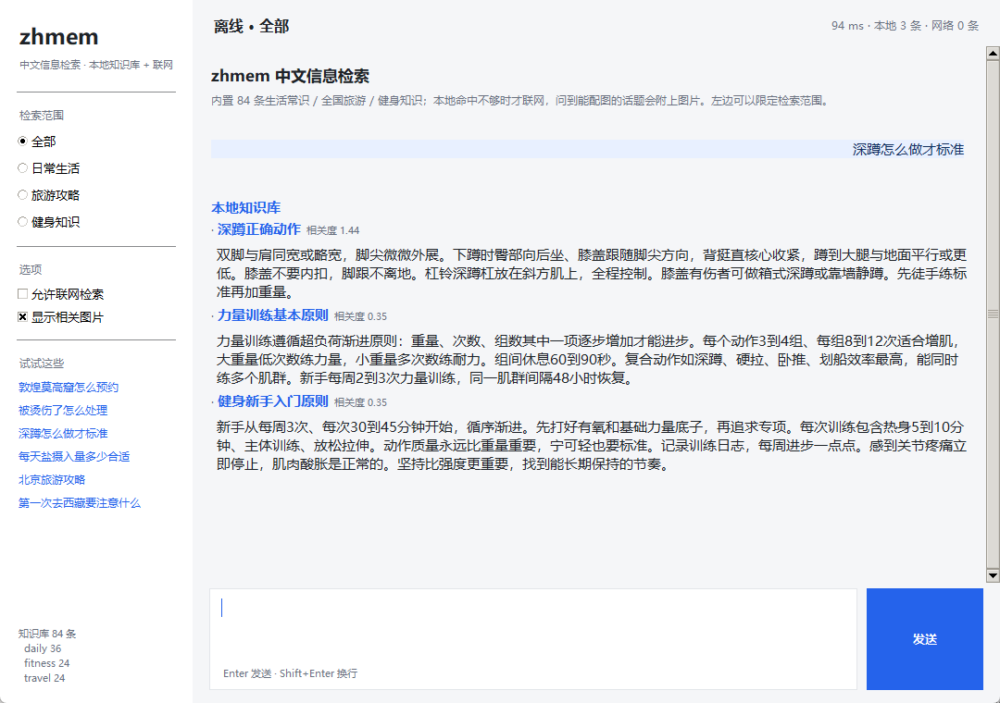

# zhmem

中文优先的混合信息检索库。零依赖（可选 numpy），纯 Python + SQLite FTS5。

## 下载后直接用（3 秒）

**Windows**：双击 `启动.bat`，弹出一个桌面窗口，直接输入问题。
**macOS / Linux**：`./start.sh`。

脚本会自动找 Python、首次运行时装好依赖，然后打开窗口版；万一没有图形环境，
同一个脚本自动退回命令行问答，不会卡住。命令行里输入 `深蹲怎么做才标准` 试试，
`/help` 看命令，`/quit` 退出。

桌面窗口长这样（左边选检索范围，右边问答，命中带相关度和来源链接）：



窗口版也可以单独启动：

```bash
python -m zhmem gui        # 装好后：zhmem gui / zhmem-gui
```

纯 tkinter，不需要 Electron 也不需要起本地服务；图片用 Pillow 缩略（没装 Pillow
就退回成链接，功能不受影响）。

要从 GitHub 安装成命令行工具（之后任意目录都能用）：

```bash
pip install git+https://github.com/woc-jpg/zhmem.git
zhmem                          # 交互式问答（终端）
zhmem gui                      # 桌面窗口
zhmem ask "敦煌莫高窟怎么预约"     # 单次问答
zhmem stats                    # 知识库统计
```

用源码安装：`pip install -e .`。核心零第三方依赖；联网/图片用标准库 urllib；
向量路径需 `zhmem[vector]`，WorkBuddy 的 MCP 服务器需 `zhmem[mcp]`，想把搜到的
图片显示成缩略图需 `zhmem[gui]`（Pillow，只影响缩略图，不装也能用）。
离线环境在交互模式输入 `/offline` 即可，不会发起任何网络请求。

不想装 Python 环境的话，还有一个纯 Node 的版本：**[dsh-plugin-zhmem](https://github.com/woc-jpg/dsh-plugin-zhmem)**
——下 zip、双击 `启动.bat` 就能用，一样的知识库、一样的打分逻辑（有 parity 测试逐位比对），
只是换了个运行时。两边读写同一种数据库。

它有两个层次，共用同一套打分内核：

1. **个人记忆检索层**（`MemoryStore`）——给它一堆「某人说过的话」，问一句，
   返回最相关的几条并给出打分依据。全套指标和消融表在仓库里，可复现。
2. **开箱即用的信息检索**（`Retriever`）——内置 84 条中文知识库（日常生活常识、
   全国旅游攻略、健身细节），本地命中弱时自动联网检索并附上来源链接，还能按
   问题同步给出相关图片。一行代码拿到带引用的 Markdown 答案。

```python
from zhmem import Retriever

r = Retriever()                       # 在线；Retriever.offline() 完全离线
ans = r.ask("敦煌莫高窟怎么预约")
print(ans.render())                   # 本地知识 / 网络资料 / 相关图片 三段
r.close()
```

```python
from zhmem import MemoryStore

s = MemoryStore("memories.db")
s.add("mum", "膝盖不太好，阴雨天会疼", kind="fact", salience=0.9)
s.add("mum", "喜欢喝普洱，不加糖，下午三点左右", kind="preference")

for hit in s.recall("mum", "我膝盖疼怎么办", limit=3):
    print(hit.score, hit.body, hit.parts)
# hit.parts -> {'lexical': 0.5, 'semantic': 0.0, 'recency': 0.99, 'salience': 0.9}
```

命令行单次用法（交互用法见文首）：

```
python -m zhmem                                        # 无参数 = 交互问答
python -m zhmem gui                                     # 桌面窗口
python -m zhmem stats                                   # 知识库统计
python -m zhmem ask "深蹲怎么做才标准" --offline          # 只查本地
python -m zhmem ask "敦煌莫高窟怎么预约"                  # 本地 + 联网 + 图片
python -m zhmem eval                                    # 记忆检索评测（只打印）
```

装好后对应的命令是 `zhmem ...`（如 `zhmem ask "..."`）；测试需 `pip install ".[dev]"`。
代码里传 `offline=True` 可彻底关掉网络（`Retriever.offline()`）。

**在 WorkBuddy / CodeBuddy 里直接用**：zhmem 也提供 MCP 服务器，注册后助手
能直接调用「知识库问答 / 联网检索 / 图片 / 长期记忆读写」。见下方
[「接入 WorkBuddy（MCP）」](#接入-workbuddymcp) 一节。

## 它解决什么

通用向量库在「几百条短记忆」这个形状上并不好用：中文分词要么依赖词典
（jieba），要么用 trigram 丢掉两字词；BM25 在小语料上 IDF 直接塌成 0。
zhmem 把每条记忆切成单字+二元词建进 FTS5，用**查询覆盖率**而不是 bm25 打分，
同义词在**索引和查询两侧同时折叠**，并让上一轮对话作为独立查询参与打分，
而不是拼进当前这句。每个决定下面都有实测数字，不是拍脑袋。

## 实测指标

```
python -m zhmem.eval     # 下面这些数字的来源；达不到阈值会非零退出（CI 用这个）
```

```
== zhmem (memory store) ==
Recall@1=0.981  Recall@3=1.000  Recall@5=1.000
nDCG@1=0.914  nDCG@3=0.993  nDCG@5=0.993
MRR=0.990   false-positive-rate=0.125
-- by category --
  paraphrase  n=22  hit=1.000  MRR=1.000  FPR=0.000
  context     n=14  hit=1.000  MRR=0.964  FPR=0.000
  switch      n= 6  hit=1.000  MRR=1.000  FPR=0.000
  multihop    n=10  hit=1.000  MRR=1.000  FPR=0.000
  negative    n=16  hit=0.000  MRR=0.000  FPR=0.125
```

评测集 68 条查询、6 个 persona、60 条记忆，**全部手写并带 gold**，五类正负样本
分开报数——这是为了能回答「87% 怎么测的」：指标和答案都在仓库里，可复现。
五类正向查询命中率全部 100%，负例误报率 0.125（16 条里 2 条），这 2 条是
真正的语义近邻（问「她数学考了多少分」命中「数学期中考试」），不是随机噪声。

## 每个设计决定的实测依据

跑 `python -m bench.ablation` 可复现下面这张表（每行只改一个开关）：

| 变体 | R@1 | R@5 | MRR | FPR |
|---|---|---|---|---|
| **默认** | **0.981** | **1.000** | **0.990** | **0.125** |
| scorer = bm25 | 0.827 | 0.981 | 0.901 | 0.750 |
| tokenizer = trigram | 0.462 | 0.462 | 0.462 | 0.000 |
| 同义词只折叠查询侧 | 0.827 | 0.846 | 0.837 | 0.125 |
| 同义词只折叠索引侧 | 0.904 | 0.923 | 0.913 | 0.125 |
| 两侧都不折叠 | 0.827 | 0.846 | 0.837 | 0.125 |
| 每个字都给单字权重 | 0.981 | 1.000 | 0.990 | **0.750** |
| 关掉单字兜底（char_tier=off） | 0.981 | 1.000 | 0.990 | 0.125 |
| 不使用上一轮（context_weight=0） | 0.885 | 0.904 | 0.889 | 0.125 |
| 上一轮拼进当前查询（旧做法） | 0.923 | 1.000 | 0.962 | 0.125 |

**1. 不用 bm25，用查询覆盖率。** 4 条语料里某个词出现在 2 条 → IDF 恰好为 0，
`bm25()` 对每行都返回 `-0.0000`，排序掉到 recency。实测一次「胃不舒服」问答
把「膝盖」排在真正含「胃」的记忆前面。覆盖率是绝对值（命中词权 / 查询总权），
小语料上不会因为「一堆烂结果里最好的」被拉成 1.0。

**2. 覆盖率不做 min-max 归一。** 上面那条老 bug 的另一半：全 0 的结果做
min-max，最大那个会变成 1.0，看起来像完美匹配。`coverage()` 永远是绝对值。
（min-max 的失败只在「所有候选都得 0」时出现，是集合级操作，无法用单行的
`coverage()` 打补丁复现，所以没放进消融表——详见 `zhmem/text.py` 的说明。）

**3. 不用 trigram，用 unicode61 + 预切分单字/二元词。** 两字词「普洱」在
trigram 下产生不了任何 token（trigram 至少三个字），所以 trigram 的 recall
只有 0.462。把「普洱」索引成 `普 洱 普洱` 后二元词可被精确匹配。

**4. 同义词在索引和查询两侧同时折叠。** 只折叠一侧反而更差：记忆存的是
「睡不着」，查询「老人家失眠」被折叠成「失眠」，FTS5 找不到任何行，
但没有任何报错——记忆静默失联。两侧都折叠让 paraphrase 从 0.827 回到 1.000。
`fold()` 是单次最长匹配，避免顺序 `replace` 把「拉肚子」二次折叠成「拉腹部」。

**5. 单字兜底只给孤立字满权重。** 「咖啡怎么喝」剥掉疑问词后只剩一个「喝」，
它是整个话题，必须给满权；但「量子力学」和「小学二年级」共享的「学」是词内字，
给 0.2 就会在 9 条负例上盖过真实匹配。当前规则：词优先，任何二元组命中就不算
单字；二元组全不中时每候选才用单字兜底、封顶 0.25。这样 FPR 从 0.750 降到
0.125，同时 recall 不降。

**6. 上一轮作为独立查询、取加权最大值，绝不拼接。** 拼接最近三轮会让每个旧话题
都参与投票，第三问会回到第一问的记忆。但完全不看上一轮，代词追问（「放在哪儿了」
「她叫什么」）的 recall 只有 0.885。`recall()` 把当前句和上一轮分别检索、分别
打分，取 `max(当前, 0.6 × 上一轮)`：真话题切换时当前句的强匹配不被稀释，
纯代词追问时上一轮把它抬起来。评测集专门加了 6 条 `switch`（新话题+无关上一轮）
作为对照组——正是它们让「拼接上一轮」的 R@1 从虚高的 1.000 回落到真实的 0.923。

**7. 有正向词面/向量证据才入榜。** recency 和 salience 只做平局裁决。没有这条
下限，一条新鲜又高重要度、但和查询毫无关系的记忆会以 0.25 的综合分排在第一，
而且看起来很自信。

**8. min-max 覆盖率与「覆盖率当绝对量」的取舍**：见第 2 条。

**9. 内置知识库的标题匹配用「短主题段 + 字符 IDF」，且只对知识库开启。**
知识库条目有手写标题（「每天盐摄入量」），而用户问的是「盐吃多了会怎样」——
词面上没有共同二元组。给 `MemoryStore` 加一个默认关闭的 `subject_bonus`，知识库
把它打开：取问题剥掉疑问词后的**第一个内容段**，按字符与标题比对，共享字符按
全库**文档频率**加权（稀有字「盐」df=1 压过常见字「多」df=9）。两个限制是实测
加的：段超过 4 字（「量子计算机原理」）不算主题词，否则它会跟「力量训练基本
原则」共享「量」而挡住联网兜底；个人记忆默认关闭，避免空标题凭空造证据。
`subject` 作为独立信号进 `parts`，不污染词法分。

## 信息检索：内置知识库 + 联网 + 图片

`Retriever.ask()` 是这个层次的统一入口，按三层顺序组装，每层都可在构造时替换
（依赖注入，测试用假 provider，零网络）：

1. **本地知识库优先**——免费、快、确定，84 条内置条目覆盖三块内容：

   | 命名空间 | 条数 | 内容 |
   |---|---|---|
   | `daily` | 36 | 饮食摄入量、睡眠、发烧/烫伤/止血/心肺复苏/海姆立克等急救、用电用火地震、清洁收纳、用药、理财、防溺水防蛇咬 |
   | `travel` | 24 | 北京/上海/西安/桂林/敦煌/成都/杭州/苏州/张家界/拉萨/云南/三亚/厦门/青岛/重庆/武汉/南京/日本/泰国等攻略，加证件、打包、乘机、酒店、拍照常识 |
   | `fitness` | 24 | 深蹲/硬拉/卧推/平板支撑/引体向上动作细节、肌群与频率、增减脂、营养蛋白、热身拉伸、恢复、损伤预防、HIIT、瑜伽、跑步配速、游泳、体脂率、补剂证据等级、女性/中老年健身 |

2. **联网兜底**——本地最佳**证据分**（`max(lexical, semantic, subject)`，不含
   recency/salience）低于 `web_threshold`（默认 0.45）才请求网络。阈值用证据
   分而非总分：零证据的行靠 recency/salience 也有约 0.25 底分，会误吞
   「python怎么安装」这类该联网的问题。
   `BingProvider` 解析 `cn.bing.com/search`，只收标题+摘要齐全的结果，返回
   带 URL 的 `WebResult` 引用；provider 异常一律吞掉返回空（可传 `strict=True`
   抛错），网络不可用时 `Retriever` 照常工作。

3. **相关图片**——命中条目带 `image_query`（英文），用它而不是用户原句去搜图，
   中文原句在图片搜索里召回很差。`BingImages` 解析必应图片的 `iusc` 数据；
   `CommonsImages` 走 Wikimedia API 并附 CC 许可证名，版权可追溯。两者按序
   尝试、不合并（必应更相关但版权不清，Commons 可商用但中文召回差），
   `prefer_commons=True` 可换序。`ImageResult.markdown()` 直接出图片链接。

网络层全部用标准库 `urllib` 实现，无 requests 依赖。联网端点是实测选的：
必应网页/图片搜索稳定；维基百科中英文 API、知乎、百度百科要么超时要么 403。
所有 provider 都可注入假实现，网络行为不进单元测试。

## 桌面窗口版

`python -m zhmem gui`（装好后 `zhmem gui` 或 `zhmem-gui`）打开一个窗口，
不用记命令，适合给不熟命令行的人用：

- 左侧选**检索范围**（全部 / 日常生活 / 旅游攻略 / 健身知识）与两个开关
  （允许联网检索、显示相关图片）；示例问题点一下就问。
- 右侧是对话流：本地条目显示标题 + 相关度 + 正文，网络结果显示标题、原文链接
  和摘要，能配图的话题在下方贴缩略图；顶部状态行给出耗时和本地/网络命中条数。
- 最近三轮提问会作为 `recent` 传给检索，所以「那次怎么样」这类追问也能接上。

实现上只有标准库 tkinter：检索跑在工作线程里，结果经 `queue` 回到 UI 线程
（`after()` 轮询），所以联网慢的时候窗口不假死；Pillow 装了就把缩略图缩到
220×160，没装就退回成图片链接。`Retriever.ask(namespaces=...)` 是为这个筛选
加的公开参数，命令行和库调用都能用。

## 向量路径（可选）

```python
from zhmem import MemoryStore

class Embedder:
    def embed(self, text):  # -> list[float]
        ...

s = MemoryStore("m.db", embedder=Embedder())
# 向量相似度与词面分数加权融合；低于 semantic_floor(0.20) 的相似度不计入
```

没有 embedder 时是纯词法检索，零依赖。向量是暴力余弦（几千条内微秒级），
不引入向量数据库。

## API

```
MemoryStore(path=':memory:', *, normalize=fold, query_normalize='same',
            scorer='coverage', tokenizer='bigram', weights=None,
            half_life_days=30, semantic_floor=0.20, char_tier=True,
            context_weight=0.6, subject_bonus=0.0, embedder=None, clock=utcnow)
  .add(namespace, body, *, kind='note', subject='', salience=0.5, meta=None,
       search_text=None) -> id
  .get(id) / .all(namespace=None) / .count(namespace=None)
  .forget(id) -> bool / .clear(namespace=None) -> int / .reindex() -> changed
  .recall(namespace, query, *, limit=8, candidate_limit=200, kinds=None, recent=()) -> list[Recalled]
  .render(hits, *, max_chars=1800, max_items=8) -> str   # 生成 prompt 片段
  .close()

Recalled(memory, score, parts)   # .parts = {lexical, semantic, recency, salience, subject}
```

`recent` 传最近的用户轮次（字符串序列）。命中对象可直接 `hit.body` / `hit.kind`。
`search_text=` 让调用方把 tags 折进索引而不污染 `body`（否则答案末尾会出现标签串）。

```
Retriever(*, kb=None, web=None, images=None, offline=False,
          web_threshold=0.45, local_limit=3, web_limit=5, images_limit=3)
  .offline() -> Retriever          # 完全离线、确定性的构造快捷方式
  .ask(query, *, recent=(), web=None, images=True, limit=5) -> Answer
  .close()

Answer.query / .local / .web / .images
  .text                            # 本地命中正文拼接
  .local_citations()               # 带 [标题（本地知识库）] 的引用
  .render(*, images=True, limit=5) # 三段式 Markdown 答案
WebSearch(provider=None, *, offline=False, timeout=10.0, strict=False)
BingProvider(fetch=None, base='https://cn.bing.com/search')
ImageSearch(bing=None, commons=None, offline=False, timeout=12)
  .search(query, limit=4, *, prefer_commons=False)  # prefer_commons 是 search 参数
KnowledgeBase(path=':memory:', *, namespace=None, **store_kwargs)
  .counts() -> dict[str, int] / .store / .close()
```

知识库条目是 `zhmem/kb/data/{daily,travel,fitness}.json`，每条包含
`id/title/body/tags/image_query/salience`。`load_entries()` 读取并校验唯一性，
`install(store)` 装进任意 `MemoryStore`，条目可自由增补——加一行 JSON 即可。

## 测试

```
python -m pytest          # 75 passed（记忆 + 知识库 + 网络 + MCP + 启动器 + 桌面窗口，零网络）
python -m zhmem.eval      # 记忆检索指标 + 阈值门禁，不达标则非零退出（CI 用这个）
python -m zhmem eval --all # 同一份报告，额外打印每条查询明细；只打印、不做门禁
python -m bench.ablation  # 消融表，写 bench/ablation_results.json
```

CI（`.github/workflows/ci.yml`）在 Python 3.10–3.13 上跑上述命令，外加 CLI
离线冒烟测试；网络相关测试全用保存的 HTML/JSON fixture，CI 不依赖外网。
桌面窗口的 6 项测试在没有显示器的机器上自动 skip（`pytest.importorskip`），
所以 Linux 无头 CI 不会因此变红。

## 接入 WorkBuddy（MCP）

zhmem 本身只是 Python 库，WorkBuddy 默认调不到。项目带了一个零配置的 MCP
server（`zhmem.mcp_server`），用 stdio 通信，注册后助手就多了 8 个工具：

| 工具 | 作用 |
| --- | --- |
| `zhmem_ask` | 知识库优先回答问题，必要时联网、附图；`web_mode` 可设 auto/always/never |
| `zhmem_web_search` / `zhmem_image_search` | 单独联网查资料 / 找配图 |
| `zhmem_remember` / `zhmem_recall` / `zhmem_forget` / `zhmem_list_memories` | 长期记忆的写、召回、删、列 |
| `zhmem_stats` | 知识库条数、记忆条数、数据库路径 |

**在本机已配置好**（写的是绝对路径，换电脑要改）：配置文件
`~/.codebuddy/.mcp.json` 与 `~/.workbuddy/.mcp.json`，内容是：

```json
{
  "mcpServers": {
    "zhmem": {
      "type": "stdio",
      "command": "D:\\tools\\python\\python.exe",
      "args": ["-m", "zhmem.mcp_server"],
      "env": {
        "PYTHONPATH": "D:\\17221\\Documents\\deepseek-harness\\default-workspace\\zhmem",
        "PYTHONIOENCODING": "utf-8"
      }
    }
  }
}
```

工具名前缀是 `mcp__zhmem__`（如 `mcp__zhmem__zhmem_ask`）。重启 WorkBuddy
后生效；在设置 → MCP 里能看到 zhmem 已连接。记忆默认存在
`~/.workbuddy/zhmem-memory.db`，可用环境变量 `ZHMEM_DB` 改路径。

换电脑 / 发布给别人的注册方法（任选其一）：

```
codebuddy mcp add --scope user zhmem -- \
  /path/to/python -m zhmem.mcp_server
```
或手工编辑 `~/.codebuddy/.mcp.json`（写法同上，把 command/PYTHONPATH 改成
对方机器上的实际路径）。命令行工具可用 `codebuddy mcp list` / `mcp get zhmem`
核对，`/mcp` 命令查看连接诊断。

注意：MCP SDK 是可选依赖，`pip install "zhmem[mcp]"` 后才装；不装时核心库和
CLI 完全正常，`tests/test_mcp.py` 会自动跳过。

## 已知边界

- 同义词表是手写的，覆盖的是这类家庭记忆里高频的说法，不是通用词典。
  真实语义相似度请接 embedder（`embedder=`）。
- 两条残余负例误报都是真近邻（共享「数学」等实词）；纯词法无法区分，
  接向量后可望解决。
- 向量索引是暴力扫描，适合千级记忆；十万级需要换 AnnIndex。
- 内置知识库是精心手写的 84 条入门资料，不是百科全书：问到没覆盖的话题
  会走联网兜底（在线时）或明确说没找到（离线时）。要更全就往 JSON 里加条目。
  注意：知识库把 tags 折进检索索引（`search_text`），直接改 JSON 后需要重启
  进程重建索引；`MemoryStore._idf_cache` 目前不在 `add()` 时失效，知识库是
  构建时一次性装入的所以无影响，若将来做运行时增改要清这个缓存。
- 联网依赖必应网页/图片端点（实测可用），端点改版时解析会失效——provider
  可注入替换，异常默认吞掉不会让程序崩溃，但会静默失去网络结果。
- Wikimedia Commons 图片有 CC 许可信息，必应图片版权不明；需要可商用素材
  时用 `ImageSearch().search(query, limit=4, prefer_commons=True)` 并以
  `ImageResult.license` 为准。
- 本库是检索层，不是服务：核心库无鉴权、无 HTTP 层、无多租户隔离。MCP
  server 只面向本机 WorkBuddy（stdio），长期记忆是单 SQLite 文件、无并发
  控制与权限隔离；要对外服务需自行包一层并做鉴权与限流。
- MCP 工具返回的图片是外链（必应/Commons），在 WorkBuddy 里能否渲染取决于
  客户端与站点策略；纯文本引用始终可用。
